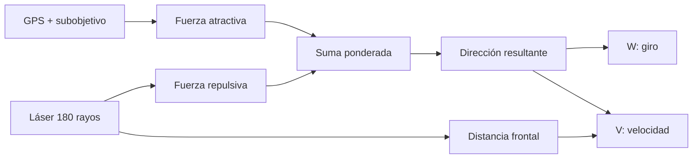

## Guion de funcionamiento

### Idea general: VFF

Cada elemento del entorno genera una fuerza virtual sobre el coche:

- **Fuerza atractiva:** el waypoint atrae al coche.
- **Fuerza repulsiva:** cada obstáculo detectado por el láser lo empuja en sentido contrario.
- **Fuerza resultante:** la suma ponderada de ambas indica hacia dónde debe dirigirse el coche.

La aplicación es un bucle infinito. En cada iteración se siguen estos pasos:

### 1º. Procesamiento del láser
El láser devuelve 180 medidas, una por grado, con la medida 90 apuntando al frente del coche. Cada medida se convierte a un ángulo relativo al coche (positivo a la izquierda). Las lecturas inválidas o infinitas se tratan como "sin obstáculo" y todas las distancias se limitan a una **distancia de influencia**, a partir de la cual un obstáculo deja de repeler.

### 2º. Fuerza atractiva
La posición del subobjetivo viene en coordenadas absolutas del mapa, así que se resta la posición del coche y se **rota** según su orientación para pasarla al sistema de referencia del coche. Se normaliza, de modo que la fuerza atractiva tiene módulo constante y solo aporta la dirección hacia la que hay que ir.

### 3º. Fuerza repulsiva
Cada uno de los 180 rayos genera un vector de repulsión que apunta en sentido contrario al obstáculo, con una magnitud **inversamente proporcional a la distancia**: un obstáculo cercano repele mucho más que uno lejano, y a partir de la distancia de influencia no repele nada. Se suman todos los vectores y el resultado se normaliza por el número de rayos. Esto hace que el coche tienda a centrarse entre las dos vallas y a apartarse de los coches que encuentra.

### 4º. Combinación de fuerzas
Aquí se aplica el truco que propone el enunciado del ejercicio. La repulsión total casi siempre apunta hacia atrás, porque casi siempre hay obstáculos por delante, y sumarla tal cual haría que el coche frenara o diera marcha atrás. Como el coche debe avanzar siempre, **la componente de avance se mantiene siempre positiva** y es la **componente lateral** de la suma (atracción + repulsión) la que decide hacia qué lado girar. De esa forma, la esquiva se materializa únicamente en la dirección.

### 5º. Traducción a V y W
- **Velocidad angular (W):** proporcional al ángulo de la dirección resultante, limitada a un máximo y suavizada con un filtro paso bajo para evitar bandazos y oscilaciones.
- **Velocidad lineal (V):** va al máximo en recta libre y se reduce de forma progresiva según dos factores: lo cerca que está el obstáculo frontal y lo cerrado que es el giro. Si hay vallas muy pegadas a los lados, se reduce un poco más.

### 6º. Cambio de subobjetivo
Cuando el coche está dentro de un radio determinado del subobjetivo, este se marca como alcanzado **sin detener el coche** y se pasa al siguiente. Así no se pierde tiempo frenando en cada punto.

### Problemas encontrados y soluciones

**La repulsión apunta hacia atrás.** Sumada directamente a la atractiva producía una dirección que frenaba o invertía el movimiento. Se solucionó manteniendo positiva la componente de avance y dejando que solo la componente lateral gobierne el giro.

**Indecisión (fuerzas que se anulan).** Con un obstáculo justo delante, las repulsiones de izquierda y derecha se compensan y la fuerza lateral es casi nula, así que el coche seguiría de frente hacia el obstáculo. En ese caso se compara el espacio libre de cada lado y se fuerza un giro hacia el lado con más hueco. Se añadió **histéresis**: solo se cambia de lado cuando la diferencia es clara, para que no oscile entre izquierda y derecha.

**Velocidad frente a choques.** Subir la velocidad aumentaba los choques, sobre todo en curvas y al aparecer un coche de frente, porque el coche necesita más distancia para frenar y girar. Se ajustó de forma incremental, subiendo la velocidad máxima poco a poco y reforzando a la vez la seguridad: una distancia de influencia mayor para empezar a esquivar antes, un frenado progresivo según la distancia frontal y una reducción de velocidad en los giros cerrados, con una velocidad mínima para no perder tiempo en exceso.

**Oscilaciones.** Un giro demasiado reactivo hacía que el coche zigzagueara en las rectas. Se limitó la velocidad angular máxima, se añadió un filtro paso bajo al giro y se ajustó la ganancia de dirección hasta encontrar un compromiso entre reaccionar rápido y no oscilar.

**Coche atascado.** Una limitación conocida del VFF es que puede quedarse bloqueado. Si el coche lleva varias iteraciones con un obstáculo muy cerca de frente, retrocede girando hacia el lado más libre durante un tiempo y retoma la navegación.

## Vídeo del funcionamiento

https://youtu.be/wmLxZhFRpTU (Enlace al video de youtube del funcionamiento)

## Conclusiones

Como se aprecia en el vídeo, el coche completa el circuito a gran velocidad, esquivando todos los obstáculos que encuentra y pasando de waypoint en waypint sin detenerse. Se observa un ligero temblor en algunas secciones, pero no afecta al funcionamiento general ni provoca choques. Su origen está en que la velocidad angular máxima se ha fijado muy alta, junto con la velocidad lineal, con el objetivo de minimizar el tiempo de vuelta. Podría solucionarse bajando un poco la velocidad angular máxima, a costa de ser algo más lento en las curvas.
