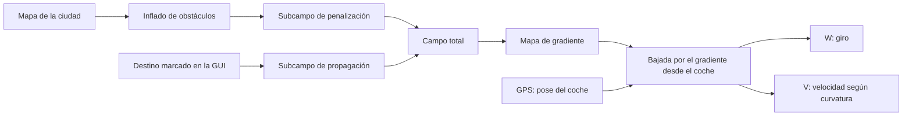

## Guion de funcionamiento

### Idea general: Gradient Path Planning (GPP)

El coche no sigue una ruta fija: se calcula un **campo escalar** sobre el mapa de la ciudad y el coche lo consulta en cada iteración para saber hacia dónde moverse. El destino actúa como un pozo de potencial y los obstáculos como paredes, de modo que el camino es siempre una bajada.

El campo total es la **suma de dos subcampos**:

- **Subcampo de propagación a destino:** una ola (wave front) que parte del destino y se extiende por toda la carretera. El valor de cada celda es la distancia mínima al destino.
- **Subcampo de penalización por cercanía a obstáculos:** cada celda cercana a un obstáculo recibe un coste extra que baja al alejarse de él. Hace que el coche prefiera ir centrado en la carretera.

La aplicación es un bucle infinito. Cada vez que el usuario marca un destino nuevo se calcula el campo, y en cada iteración se siguen estos pasos:

### 1º. Procesamiento del mapa 
La imagen del mapa se traspone para trabajar con celdas `[fila, columna]`. Las celdas blancas son carretera y las oscuras obstáculos. Los obstáculos se **inflan** 1,5 celdas para que el coche nunca planifique pegado a ellos. Las conversiones entre celdas de la rejilla y coordenadas del mundo se hacen con una transformación lineal calculada una vez, así no hay que llamar a la GUI en cada iteración.

### 2º. Subcampo de penalización 
Para cada celda se calcula la distancia al obstáculo más cercano. La penalización vale `OBSTACLE_PENALTY` (3,0) junto al obstáculo y baja linealmente hasta 0 a `PENALTY_RADIUS` (4 celdas). Es independiente del destino, por lo que no se recalcula al cambiarlo.

### 3º. Subcampo de propagación 
Se lanza una ola desde la celda destino con Dijkstra de 8 vecinos (coste 1 en recto y √2 en diagonal, sin cortar esquinas de obstáculos) sobre **toda** la carretera. El resultado es la distancia mínima de cada celda al destino. Si el destino cae fuera de la carretera, se ajusta a la celda libre más cercana.

### 4º. Campo total y gradiente
Se suman los dos subcampos: `potencial = propagación + penalización`. Después se construye un **mapa de gradiente**: para cada celda, la celda vecina de menor potencial. El campo total se dibuja en la GUI en escala de grises (oscuro = cerca del destino) y la ruta que sugiere desde la posición inicial se muestra sobre el mapa.

### 5º. Consulta reactiva del campo 
Con la pose del coche (GPS), se localiza su celda y se **baja `WALK_STEPS` (24) celdas por el gradiente**. Ese tramo local se suaviza para eliminar el zig-zag de la rejilla, y se pasa a metros.

### 6º. Traducción a V y W
- **Velocidad angular (W):** el coche apunta a un punto de *lookahead* del tramo local (a una distancia entre 2,5 y 12 m, que crece con la velocidad). W es proporcional al ángulo hacia ese punto y está limitada a `MAX_W`. Si el error de ángulo es muy grande, el coche gira sin avanzar.
- **Velocidad lineal (V):** se calcula una velocidad máxima admisible en cada punto del tramo local según su curvatura (`v = √(A_LAT / curvatura)`) y se frena con antelación antes de las curvas y del destino. V se reduce además cuando el coche no está alineado con el punto de lookahead.

### 7º. Llegada y espera
Al entrar en un radio de 2 m del destino, el coche se detiene y **espera**. Cuando el usuario pica otro punto del mapa, se recalcula el campo y el coche vuelve a moverse.

## Vídeo del funcionamiento

Video de Youtube: https://youtu.be/MuEMApx5b2c

## Conclusiones

Como vemos en el video, el coche se queda quieto hasta que se marca una zona en el mapa, una vez marcada se mueve hasta llegar, quedandose quieto en espera de una nuvea marca. Tambien se ve en el video que se puede cambiar de merca en mitad de un recorrido como un GPS real. EL unico problema es que se suele acercar mucho a las paredes y hace curvas cuando se abren caminos nuevos. Pero fuera de eso su funcionamiento es buenp y resistente.
